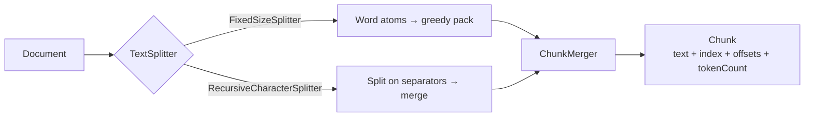

# java-text-chunker

Token-aware text chunking for Java RAG and LLM pipelines. **Zero runtime dependencies** — pure JDK 17.

## Why

Every RAG pipeline starts the same way: cut documents into chunks that fit the model's context window, with enough overlap that meaning doesn't get sliced in half. Python has `langchain_text_splitters` for this. Java's options are thin. This library fills that gap with two splitters, a one-method tokenizer interface, and chunks that carry their own offsets and token counts.

## Quickstart

```xml
<dependency>
    <groupId>io.github.harshaeethakota</groupId>
    <artifactId>java-text-chunker</artifactId>
    <version>0.1.0</version>
</dependency>
```

```java
import io.github.harshaeethakota.textchunker.*;
import java.util.List;

Tokenizer tokenizer = new WordTokenizer(); // or your own BPE tokenizer
TextSplitter splitter = new RecursiveCharacterSplitter(tokenizer, 500, 50);

List<Chunk> chunks = splitter.split(document);
for (Chunk c : chunks) {
    System.out.println(c.index() + " [" + c.tokenCount() + " tokens]: " + c.text());
}
```

## How it works



1. **Split** — the document is cut into small pieces: word atoms (`FixedSizeSplitter`), or recursive separator splitting that prefers paragraph breaks over line breaks over word breaks over characters (`RecursiveCharacterSplitter`).
2. **Merge** — pieces are greedily packed into chunks of at most `chunkSize` tokens, each new chunk starting with roughly `chunkOverlap` tokens of trailing context from the previous one.
3. **Chunks** — every `Chunk` is an exact substring of the source (`document.substring(startOffset, endOffset)`), with its index, char offsets, and token count attached.

## Splitters

| Splitter | Best for |
| --- | --- |
| `FixedSizeSplitter` | Predictable, uniform chunks; simplest to reason about |
| `RecursiveCharacterSplitter` | Keeping paragraphs and sentences intact; the best default for prose |

## Tokenizers

`Tokenizer` is a single-method interface: `int countTokens(String text)`. Shipped baselines:

| Tokenizer | Behavior |
| --- | --- |
| `WordTokenizer` | 1 word = 1 token. Decent approximation for English prose. |
| `CharacterTokenizer` | 1 char = 1 token. Deterministic floor for tests. |

For production, plug a real subword tokenizer (e.g. a BPE implementation like jtiktoken) behind the interface so chunk budgets match your model's own tokenization. The splitters never assume anything beyond the count.

## Honest limits

- A single word longer than `chunkSize` can't be split further and is emitted as an oversized chunk (there's a test pinning this behavior).
- Overlap is approximate at piece granularity, not exact to the token.
- `tokenCount` on a chunk is the sum of its pieces' counts; separators between pieces aren't double-counted.

## Development

```bash
mvn verify
```

CI runs the build on Java 17 and 21.

## Roadmap

- Sentence-aware splitter (abbreviation-safe sentence detection)
- Markdown-aware splitter (keep headers with their sections)
- Spring Boot starter with `chunker.*` properties
- Optional jtiktoken-backed BPE tokenizer module

## License

MIT — see [LICENSE](LICENSE).
